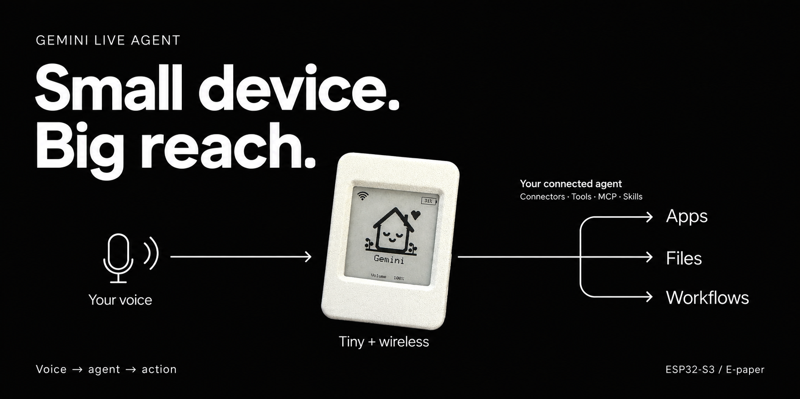
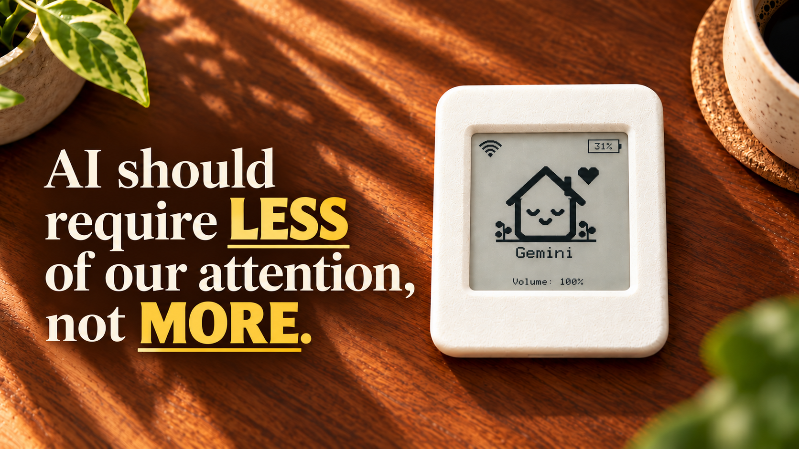
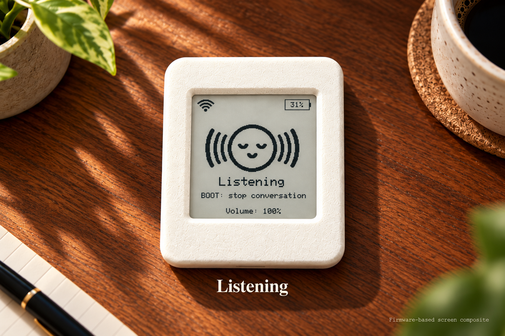
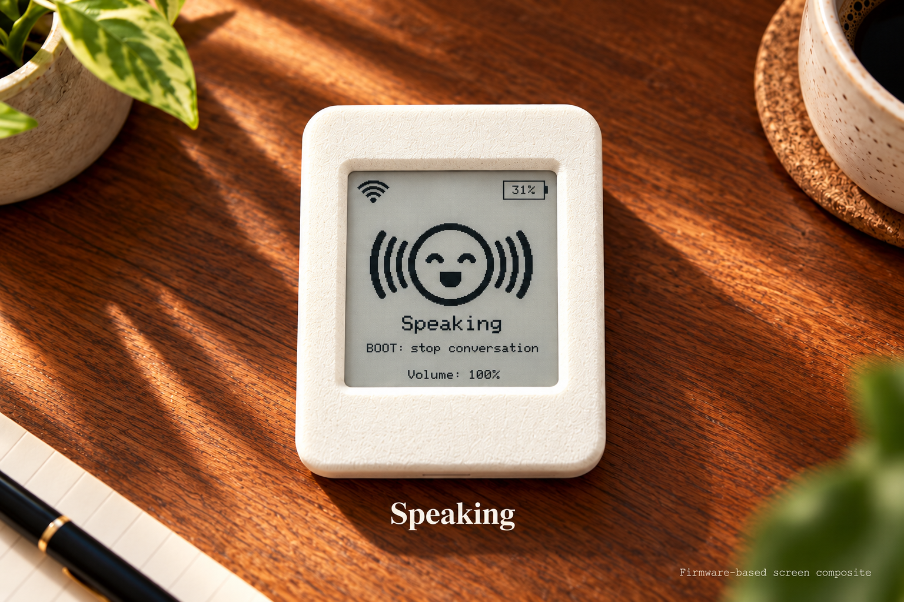
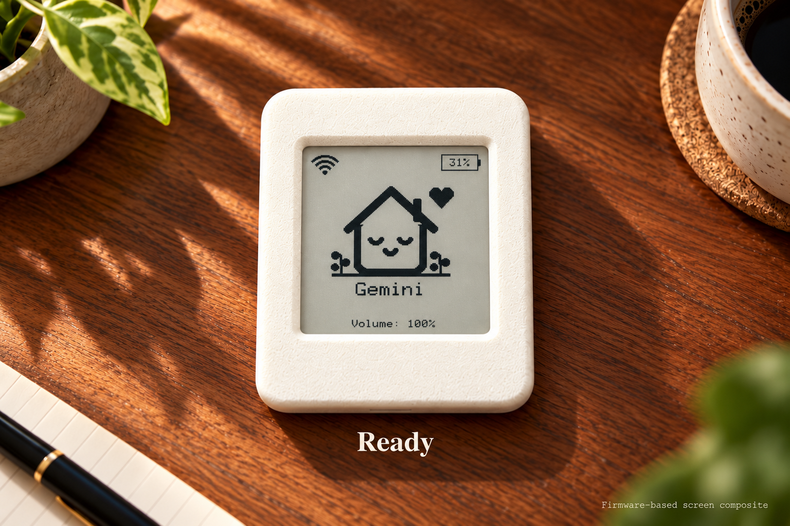
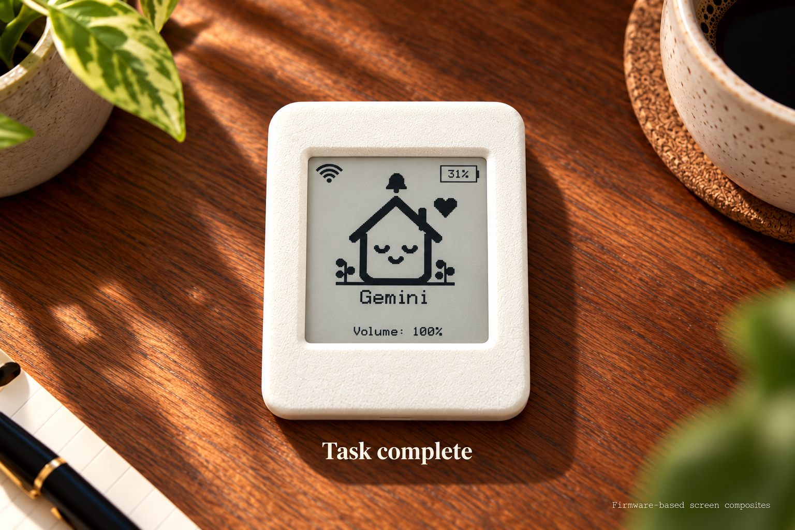
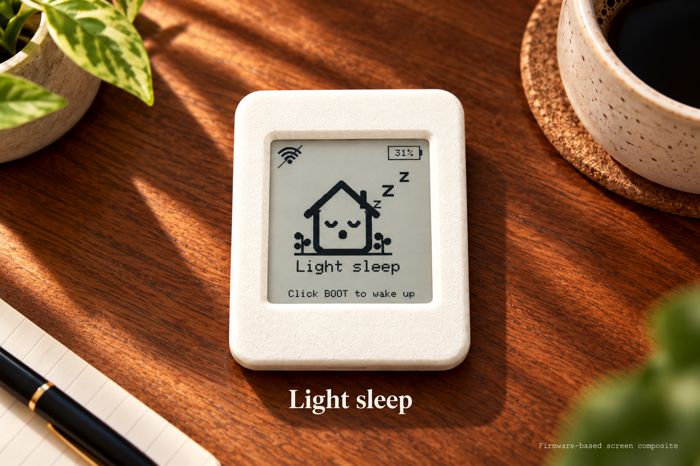

# Gemini Live Agent — ESP32-S3

Source export of the latest saved version, **v3.2 automatic Hermes routing**, saved October 5, 2026.

Voice conversations through Gemini Live, acoustic echo cancellation, e-paper status display, battery indicator, light sleep, backup Wi-Fi, and asynchronous Hermes task routing and completion notifications.

## A quiet assistant for your pocket

A pocket-sized wireless assistant for reaching AI without picking up a phone. Press BOOT, talk, and hear a response. E Ink keeps the interface quiet and glanceable.

Gemini Live handles conversation; an optional remote agent runs tool-based tasks in the background. Keep talking or end the session while work continues. A bell signals a result; start a conversation to hear it.

With the author's configured Hermes backend, the [project demo and story](https://www.cloud-monk.com/blog/going-screenless-again/) includes:

- Creating slides and emailing a link.
- Publishing a thought to X.
- Finding a coloring page and printing it at home.

These examples depend on your backend's tools, integrations, and permissions.

During idle light sleep, Wi-Fi and audio turn off; BOOT wakes the device. It cannot receive network notifications while asleep. Battery life has not yet been measured.

## Device gallery

Images from the [project blog post](https://www.cloud-monk.com/blog/going-screenless-again/); device screens are firmware-based composites.

| Voice input | Spoken response |
| --- | --- |
|  |  |

| Ready for a request | Agent result available |
| --- | --- |
|  |  |

## Build and setup

- [Build guide](docs/BUILD.md)
- [Step-by-step setup and use](docs/SETUP.md)
- [Privacy and export details](docs/PRIVACY.md)

This is device firmware; it runs on the matching ESP32-S3 hardware. Hermes is an optional backend placeholder. You can replace it with any agent through a compatible API or adapter; see [agent backend interface](docs/AGENT_BACKEND.md). The backend is a separate service and is not included. Included vendor sources retain their original licenses. No new license is granted for the application code.

The saved v3.2 checkpoint reports successful compilation, flash verification, direct-answer and Hermes-delegation tests. Microphone recognition was not verified in that checkpoint. This export makes the original personal Hermes URL configurable; the rest of the saved firmware is preserved. No hardware is flashed during export.

## Disclaimer

This repository and its contents are provided for illustration and educational purposes only as example code. This is not an official Google product or officially supported Google Cloud project. This code is provided as-is for demonstration purposes and is NOT intended or supported for production workloads. The views, code, and opinions expressed in this repository are those of the author(s) and do not necessarily reflect the position, opinions, or official policy of Google LLC or Google Cloud Platform.
